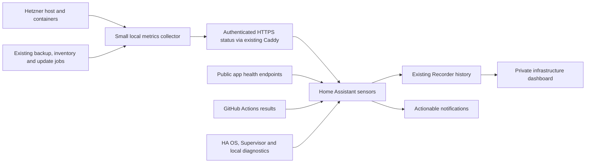

# Home Assistant infrastructure dashboard — implementation plan

Date: 25 October 2026. Status: first live version installed. The [runbook](../ops/infra-monitor/README.md) records what is running and what remains to validate.

Implementation update: Tal chose the existing **Overview → My-Dev-Apps** view instead of a separate dashboard. Server sampling, protected transport, app health, three GitHub scheduled scan results, TLS expiry, backup/recovery signals, HA update entities, resource charts and persistent issue notices are live. All dashboard entity references resolved at installation. Seven-day graphs will fill from the installation date. The longer Recorder policy, mobile push/recovery delivery, synthetic failure tests, release-to-runtime mapping, and baseline tuning remain follow-up work; the live dashboard should not be treated as proof those checks have passed.

## Purpose and scope

One private, mobile-friendly Home Assistant dashboard for Hetzner, Budgit, Parking, Plant Care and the Home Assistant device itself. Answer: Is anything broken? Did something unusual happen recently? Are backups, scans and updates working? What needs my attention?

Reuse the existing server, Home Assistant OS, GitHub workflows and backup jobs. No paid hosting, separate monitoring database, Grafana stack, HACS requirement or recurring AI session is needed for the first version. This does not reopen the completed security audit or the paused Apple Shortcut work. Monitoring reports evidence and maintenance needs; it cannot certify an application as vulnerability-free.

## 1. Architecture

Home Assistant makes outbound HTTPS requests. No incoming home-network port, public Home Assistant endpoint, root SSH credential in HA, or Docker API exposure is required. Phone and desktop display the dashboard; measurements and history do not depend on the phone being open.

**Hetzner collection:** extend the existing monitoring scripts with a bounded resource sampler and a sanitized status snapshot. Reuse the daily software inventory and existing backup status files. The collector publishes data; it cannot accept remote commands. A narrow local helper may read Docker/system status, but the web-facing component must have no Docker socket, app credentials or financial database access. Set CPU/memory/runtime limits and rotate diagnostic history.

**Transport:** use a dedicated read-only HTTPS route behind existing Caddy, with a unique monitoring credential, hashed credential storage on Caddy and the client secret in HA's server-side secrets configuration. Serve only an explicit status file, not a directory or arbitrary path. Require authentication even for historical downloads, disable caching, avoid secrets in URLs/logs, and preserve current application routes. Reuse a private network instead if one is already available; do not make a new VPN a prerequisite.

**GitHub:** HA queries the existing workflows directly every 30 minutes, independently of the Hetzner collector. Public results can be read without credentials where supported; private results use a dedicated fine-grained token limited to the three repositories and Actions read access. Git operations continue to use the existing SSH key. No Git password or deployment token belongs in the dashboard. [GitHub workflow API](https://docs.github.com/en/rest/actions/workflow-runs#list-workflow-runs-for-a-workflow)

**HA device:** enable selected existing Supervisor diagnostics, update entities and System Monitor sensors. Supervisor provides app version, running-state and resource sensors; many are disabled initially. System Monitor measures the HA machine, not the remote Hetzner server. Exact entity availability will be checked during installation through HA, without requiring a new SSH audit. [Supervisor](https://www.home-assistant.io/integrations/hassio/), [System Monitor](https://www.home-assistant.io/integrations/systemmonitor/)

## 2. Dashboard layout

Use native HA cards in the existing My-Dev-Apps view, with English labels matching Tal's Home Assistant interface and a compact phone layout. Keep diagnostic details behind drill-down links. Use text and icons alongside colours. Respect HA access permissions; a hidden sidebar entry alone is not access control.

| View | Main information | Useful follow-up |
| --- | --- | --- |
| Overview | Budgit, Parking, proxy and Plant Care status; server/HA uptime; open issues; last successful observation | Open affected service or its diagnostic view |
| Resources | Host CPU, available memory, swap activity, disk/free bytes/inodes, disk I/O and network rates; per-app CPU/memory and limit utilisation | Compare 24 hours, 7 days and 30 days; inspect peak time |
| Reliability | HTTPS response time, health response, container restarts, out-of-memory events, boot changes and failed system jobs | Correlate incidents with deployments, backups and updates |
| Security and updates | Last scan attempt, result and successful completion; scheduled-scan freshness; installed/tested release; OS packages and reboot required | Open exact failed run, release or update page |
| Backups and recovery | Each app's backup attempt, verified off-device success, age and restore-drill result; HA backup status where available | Explain which dataset is protected and what is missing |
| Home Assistant | OS/Core/Supervisor/Plant Care updates, app running state, Pi resources/storage, HA restart time and monitoring freshness | Open native update/backup settings |

At the top show four possible states: **Healthy**, **Needs attention**, **Unavailable**, **Unknown/stale**. Every result has its observation time. Never turn a missing response, expired token, failed parser or old successful result into green status or a numeric zero.

Keep sensitive data out: no budgets, uploaded reports, plant photos, backup contents, user names, IP access logs or raw environment variables. Diagnostic counters and nonsecret release identifiers are sufficient.

## 3. Measurements and history

### Collection schedule

| Source | Proposed cadence | Notes |
| --- | --- | --- |
| Host/app resource sampler | Sample every 10 seconds; emit minute summaries | Store mean, maximum and peak timestamp; define CPU normalisation explicitly |
| HA retrieval of server snapshot | Every 60 seconds | One response supplies multiple sensors; timeouts must not block HA |
| Public app health checks from HA | Every 60 seconds | Verify TLS and expected JSON, not only HTTP 200; record duration |
| Container/job state and reboot marker | Every minute | Capture restart count plus container ID/start time, since replacement resets counters |
| GitHub workflows | Every 30 minutes | Honour API limits, backoff and authentication errors |
| Installed package/release inventory | Existing daily job plus after maintenance | Do not refresh package repositories or run vulnerability scans every minute |
| Certificate expiry | Daily | Check both public hostnames from the client side |

Use HA's shared REST resource configuration so a single fetch updates related sensors. [REST integration](https://www.home-assistant.io/integrations/rest/)

Retain **14 days of detailed HA history**, with **24-hour and 7-day charts** prominent. Retain hourly resource statistics for longer trends, initially display 30 days. Use proper numeric units and `state_class: measurement` for gauges; reset-aware counters for totals. HA supports hourly min/max/mean statistics for qualifying sensors, so charts must show **maximum alongside average**, not smooth away peaks. [Statistics graph](https://www.home-assistant.io/dashboards/statistics-graph/)

The server snapshot should include a short rolling peak window (two minutes) and peak timestamp to reduce loss at polling boundaries. Keep a bounded seven-day server ring of minute summaries, capped at 50 MiB, for investigating gaps when HA was offline. Version one does not automatically import this history into HA: graphs show gaps honestly, and retained server summaries can be inspected separately. Ten-second sampling cannot guarantee capture of shorter spikes; restart/OOM event evidence complements the samples.

Changing Recorder retention affects the existing HA database. Inspect current retention, free storage and database growth before applying 14 days; never shorten an existing longer policy or replace its filters blindly. Record only useful monitoring entities, exclude rapidly changing raw JSON and large attributes, and measure added storage over the first week. HA Recorder is the history store; no second time-series database is proposed. [Recorder](https://www.home-assistant.io/integrations/recorder/)

History starts on installation. We cannot reconstruct prior CPU/RAM peaks from version inventories.

## 4. Security, updates and backup semantics

Existing baseline from the 23–25 October audit: daily security workflows and weekly Dependabot for all three apps; unattended Ubuntu security updates; scheduled backups/recovery drills; daily installed-version inventory. These are inputs to reuse, not processes to duplicate. Confirm their current configuration during implementation rather than treating this dated baseline as live evidence.

For each workflow track separately:

- Latest scheduled attempt and completion, including failure/cancellation/timeouts.
- Latest successful scheduled scan and latest successful scan of the intended release.
- Commit, event type, workflow identity, result and a direct link to that run.
- Collection health and age. More than 48 hours without a completed scheduled scan is stale; prolonged failure remains visible even if scheduling itself is active.

Use exact workflow identity and branch/event filters. An unrelated PR passing must not clear a failed production-source scan. A passing remediation run may mark the finding addressed in source while the previous scheduled failure remains in history. A workflow failure is not automatically a vulnerability: show whether available evidence identifies a finding or merely a broken check. If structured severity information is unavailable, say so and link the run; do not invent a CVE count.

Track **installed release**, **tested release eligible for deployment**, and **available upstream update** separately. Add a small nonsecret deployment manifest at future deployments (source SHA, image digest, deployed time and verification result). The newest commit is not automatically an approved release. Existing running images remain “release mapping unverified” until matched. Scanned source or a newly built image does not prove that the running image has been scanned or patched.

Host update status needs last attempt, success/failure, pending security updates where available, metadata age, reboot requirement and selected failed units. Backported distribution packages must not be labelled vulnerable solely because their upstream version number is older. Retain known maintenance items with explanations; do not hide failed jobs by clearing their status.

For backups, a timer being enabled or a local file being written is insufficient. Display last attempt separately from the last verified off-device copy and restore test, with distinct coverage for Budgit data/reports, Parking and HA. Existing Parking success must not stand in for Budgit or HA coverage. Missing evidence remains unknown. Show verification level explicitly: upload, remote-copy validation and restore test are different guarantees.

Plant Care's tested 0.13.3 source release is historical evidence, not a claim about the installed version. Read the installed version through the normal HA app entities when available; Tal continues managing HA updates.

## 5. Alerts and abnormal behaviour

Start with explainable thresholds. After seven days, compare ordinary workload patterns and tune them. A scheduled backup/build may legitimately cause a spike; show its timing rather than suppressing all high usage. Trend anomalies can be a later improvement once enough history exists.

| Condition | Initial rule | Response |
| --- | --- | --- |
| App health check fails | Three consecutive minute checks | Alert once, then recovery after sustained success |
| Server telemetry stale | No fresh sample for five minutes | Mark unknown; distinguish collector failure from app outage |
| CPU pressure | Above 90% for ten minutes | Warning; retain shorter peaks on charts |
| Memory pressure | Available host RAM below 10% for five minutes, or sustained swap/pressure | Warning; any OOM event is an incident |
| Disk/inodes | Below 15% free warning; below 8% or 2 GiB free urgent, tuned per filesystem | Keep byte and percentage views |
| Restarts | Three unexpected app restarts/replacements within 15 minutes | Incident; correlate with declared maintenance |
| Backup | Failure, or daily verified copy older than 36 hours | Warning; over 48 hours escalates |
| Monthly restore drill | Failure or no success for 40 days | Maintenance issue |
| Security scan | New failed run or no completed scheduled scan for 48 hours | Link exact run; label execution failure vs detected finding |
| Host update/reboot | Failed update job; reboot pending beyond 48 hours | Maintenance issue; no automatic reboot |
| Certificate | Under 14 days remaining; under seven days escalates | Renewal warning |
| Monitoring source fails | Expired credential, API limit, malformed data, clock skew | Monitoring issue, never “everything healthy” |

Use the existing HA mobile notification route if configured, plus persistent in-app issues. Verify delivery with one test at installation. Deduplicate repeated conditions, group failures caused by the same outage, send one recovery notice, and provide a time-limited maintenance mute that expires automatically. Persist incident state/deadlines so a HA restart does not silently reset every alert timer. Routine update proposals belong in a weekly summary only when there is something to act on; coordinate with existing GitHub emails and app backup alerts to avoid duplicate noise.

HA cannot send an alert while it is down or disconnected. If both apps and GitHub become unreachable, report a possible home connectivity problem rather than asserting that all remote services failed. A separate external HA heartbeat is an optional later stage, requiring an existing suitable destination or a separately chosen service; it is not included or claimed as working in version one. Availability percentages, if added, must exclude unknown periods and show monitoring coverage.

## 6. Implementation stages and acceptance checks

### Stage 1 — useful overview, no new resource sampler

Deliver a versioned HA configuration package, native dashboard configuration, setup guide and entity mapping. Reuse app health endpoints, current inventory/backup files, direct GitHub results and HA's own entities. Add the protected status route and required per-source timestamps/status fields. Show update/reboot/scan/backup issues and links. No automatic patch, restart or deployment buttons.

Acceptance: both apps recognised; one synthetic failed and one stale scan displayed correctly; failed backup not hidden by old success; expired monitoring credential becomes unknown; unauthenticated status requests rejected; normal app routing unchanged. Fixtures/local mocks cover failure cases without breaking production jobs.

### Stage 2 — resource history and reliable notifications

Deliver bounded collector, 14-day recording policy subject to storage review, 24-hour/7-day/max charts, event timeline and alert rules. Test a synthetic short spike, stale collector, counter reset/container replacement, HA restart and notification recovery. Check one real notification, not repeated test messages. Measure monitoring overhead on the server and Pi and reduce entity volume/cadence if needed.

Acceptance: sampled peaks remain visible after the load subsides; missing history is a gap; deployment versus unexpected restart is understandable; alert deduplication and recovery work; no secrets appear in responses, logs or dashboard exports.

### Stage 3 — tune after a week

Review disk growth and seven days of ordinary usage, adjust thresholds, confirm update/backup coverage and release mapping, and prune noisy sensors. Add baseline-relative anomalies or an external HA heartbeat only if the first version demonstrates a need. Do not block the useful dashboard on sophisticated anomaly detection.

## 7. Operating routine and boundaries

- Tal: act on urgent incidents; review the maintenance list weekly; continue HA updates on the usual cadence.
- Automation: collect metrics, retain history, run existing scans/backups/host security updates, and notify when action is needed.
- Assistance: use this dashboard's exact failed-run or incident link when a fix requires investigation. There is no need to ask an AI to repeat the entire audit regularly.
- Application releases still follow their existing tests, backup, rollback and post-deployment verification. The dashboard does not silently merge PRs, replace containers or reboot either machine.
- Installation needs normal HA configuration access, current entity IDs/storage information, a monitoring secret and confirmation of the available HA notification target. These are setup inputs, not a prerequisite to finishing this plan; no passwords/private keys should be pasted into chat.

Implementation is complete when stages 1 and 2 pass their acceptance checks and a concise installation/rollback guide is handed over. Stage 3 is scheduled tuning work to arrange during implementation, not an automation created by this plan.
