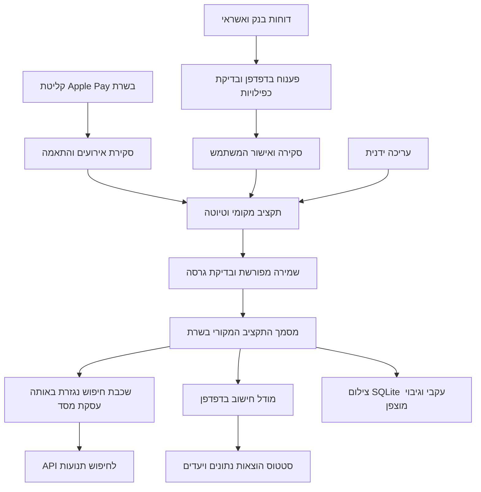

# Budgit — מתכנון תזרים לתובנות על משק הבית

מסמך המלצות מוצר, נתונים, אבטחה ופיתוח · 16.10.2026 · בסיס הבדיקה: `b97adb6`

**עדכון מצב — 18.10.2026, בדיקה מול `89cff38`:** תיאורי „כיום” וטבלת הביניים להלן משקפים את זמן כתיבתם. למצב העדכני ראו [בדיקת המימוש](HOUSEHOLD-IMPLEMENTATION-AUDIT-2026-10-18.md) ו[מטריצת הדרישות](ROADMAP-REQUIREMENTS-2026-10-18.md). חלק גדול מומש, אך יומן שינויים לפי מבצע, קישור מלא ליעד חיסכון, ארכיון מקורות ובדיקות מכשיר/שחזור מלא עדיין אינם שלמים. התוספות מהצילום מתוכננות בנפרד ב[תוכנית העדכון](ACTION-CENTER-AND-AUTOMATIC-IMPORT-PLAN-2026-10-18.md).

## ההחלטה המומלצת

להמשיך עם בסיס הנתונים והתשתית הקיימים, ולבנות מעליהם שכבת ניתוח בעלת כללים מפורשים. יש כבר בסיס טוב: הפרדת משתמשים ותקציבים, מניעת שמירה על גרסה ישנה, יבוא דוחות עם טיפול בכפילויות, מודל תזרים, וטבלאות לחיפוש בתנועות. ההשקעה החשובה הבאה היא לחבר אותם כך שכל סכום יוכל להסביר מאין הגיע, מה הוא כולל ועד כמה הנתונים שלו מלאים.

שלוש התוספות הראשונות שכדאי לקדם: **מצב שלמות הנתונים**, **מה השתנה בהוצאות**, ו־**חקירת נתונים עם מסננים ותצוגות שמורות**. אחריהן: מעקב התחייבויות, זיהוי מגמות ותרחישים המקושרים למטרות המשפחה.

הסקירה המקורית הייתה סקירת קוד וארכיטקטורה, לא ניתוח של ההוצאות האישיות בפועל ולא בדיקת חדירה. לא נפתח בסיס הנתונים החי, ולא אומת חיבור Google Drive אמיתי. המלצות העיצוב נשענות על מבנה המסכים והקוד. בשלב היישום שלהלן נבדקה התצוגה החדשה בדפדפן על נתוני דוגמה בלבד.

### עדכון יישום — 17.10.2026

החל השלב הראשון: נוספה לתצוגת ״נתונים״ אפשרות ״מה השתנה״ בין שני חודשים רצופים עם דיווח בפועל. הסכום החודשי נגזר מאותו חישוב שמזין את גרף ההוצאות הקיים; הקטגוריות נגזרות מהפירוט; ההפרש מוצג במפורש כ״ללא פירוט או התאמה״. סכום כל השינויים שווה לשינוי בהוצאות החודשיות באגורות. חודש חלקי, פירוט חסר או פירוט שאינו תואם מקבלים הסבר. אין שינוי בשמירה, בנתוני התקציב או במבנה בסיס הנתונים. בדיקות סינתטיות של חוסר, זיכוי ופערי התאמה עברו, והתצוגה נבדקה ברוחב 375 פיקסלים ללא גלילה אופקית. זהו צעד ראשון בתובנות; מצב כיסוי מאומת לפי דוחות המקור ומזהים קבועים לקטגוריות עדיין מתוכננים.

נוספה גם תצוגת ״מצב הנתונים״ לכל חודש: היא מבחינה בין דוח בנק שנקלט לחודש מלא, דוח חלקי ודיווח ידני; מפרידה בין דוח כרטיס מקובץ, סכום שהוזן ידנית וחיוב שמופיע רק בבנק; ומציגה אם פירוט ההוצאות מתאים לסך החודשי. הבדיקה מחושבת בצד הלקוח מתוך התקציב הקיים, ללא שינוי סכימה או נתונים שמורים. מצב של קובץ מקור הוא ראיה לכך שקובץ נקלט ונבדק בטווח המצוין, לא אישור עצמאי שכל תנועה אכן הופיעה בו. נותרו לעבודה: חוזה כיסוי אחיד לכל תובנה, התאמה מלאה בין קובצי מקור ותנועות, מזהי קטגוריה קבועים, ושחזור גיבוי חיצוני בסביבה מבודדת.

נוספה תצוגת ״חקירת הוצאות״ עם טווח עד 24 חודשים, קטגוריה, אמצעי תשלום וחיפוש בשם בית עסק/הוצאה. החישוב פועל על פירוט ההוצאות שכבר נטען בדפדפן, ולכן מתאים גם לתקציב מוצפן לאחר פתיחתו. רכישות וזיכויים מוצגים בנפרד; סכום הנטו הוא בדיוק סכום הרשומות שמוצגות, ללא ספירה נוספת של חיוב כרטיס או בנק. צ׳קים ממתינים וביטולים אינם נספרים, וחודשים בעריכה שטרם נשמרה מוחרגים. אפשר לשמור עד 12 תצוגות מסננים בתוך התקציב; שמירתן עוברת דרך מנגנון השמירה והגרסאות הקיים. תצוגה עם חודש נוכחי כברירת מחדל מתקדמת לחודש החדש. החקירה מוגבלת לפירוט שנקלט: אין בה עדיין פירוק של סכומים חודשיים ללא פירוט, שיוך הוצאות בנק לקטגוריות, תגיות אדם/אירוע או מדד כיסוי מלא לכל חתך. בדיקות מודל וספירת אגורות עברו; בדיקה חזותית בדפדפן לא הושלמה משום ששימוש בדפדפן המקומי היה חסום בסביבת העבודה.

נוסף כרטיס ״מגמה בשלושה חודשים סגורים״ בתוך ״קטגוריות לאורך זמן״. הוא דורש שלושה דיווחים בפועל בחודשים רצופים שהסתיימו; עלייה או ירידה מסומנת רק אם כל מעבר באותו כיוון וגם השינוי הכולל מגיע לסף כספי שהמשתמש בוחר למסך. עבור כלל ההוצאות משמש הסכום המדווח; עבור קטגוריה מסוימת נדרש בנוסף פירוט מתאים לסך בכל שלושת החודשים. חודש חסר, פתוח, בהערכה או בעריכה לא מייצר מגמה. הסכומים נטו אחרי זיכויים ולפי חודש החיוב. זו זיהוי דפוס חשבונאי, לא קביעה שההוצאה מיותרת או התראה אוטומטית. הסף נשמר רק עד החלפת התקציב או רענון, ללא שינוי נתונים שמורים.

נוספה גם תצוגת ״חוזרות״ בתוך ״נתונים״. היא מציעה מועמדים בלבד כאשר נמצא חיוב חיובי יחיד באותו שם בית עסק ובאותו אמצעי תשלום, סמוך לאותו יום בחודש, בשלושה חודשים סגורים ורצופים עם דיווח בפועל; שני החיובים הראשונים צריכים להיות דומים, וחיוב שממחזר בדיוק אותו תאריך רכישה בשלושת החודשים מוחרג כדי להקטין זיהוי תשלומים כהרשאה חודשית. מוצגים שלושת הסכומים וההפרש של האחרון, עם מעבר לרשומות המקור. המשתמש יכול לאשר, לדחות או לבטל החלטה; החלטות אלה נשמרות בתקציב באמצעות שמירה מפורשת והגנת גרסה, ותקציב מוצפן מחשב את המועמדים מקומית לאחר פתיחה. אומדן החודש הנוכחי מציג רק חיובים שאושרו ושנראו לאחרונה, אך אינו מתווסף לסכומי התקציב או לתחזית, כדי להימנע מכפל ספירה. אישור שאינו נתמך עוד בשלושה חודשים עדכניים מוצג בנפרד ללא אומדן. אלה אינם זיהוי ודאי של חוזה, מחיר ליחידה או חיוב עתידי; שינוי שם בית עסק עשוי לדרוש אישור מחדש.

נוספה תצוגת ״תקופתיות״ בתוך ״נתונים״: רישום הוצאה חד־פעמית או שנתית עם חודש חיוב צפוי, סכום, חישוב סכום היערכות חודשי עד למועד, וסימון תשלום ידני שניתן לבטל. מועד שנשאר ללא סימון אינו מתקדם אוטומטית לשנה הבאה, אלא מוצג כאיחור לבדיקה. הרישום הוא מטא־דאטה לתכנון בלבד: אינו מוכיח חיוב בפועל ואינו נוסף לתחזית או לסכומי החודש. עדכון הרשימה עובר דרך שמירת התקציב והגנת הגרסה הקיימת, ותקציבים ישנים ללא השדה החדש נשארים תקינים. בעתיד כדאי לקשר אירוע כזה לדוח מקור או לפריט מתוכנן מזוהה, כדי לדעת אם כבר תוקצב או שולם בלי ניחוש על סמך שם וסכום.

נוספה תצוגת ״תרחישים״ מתוך תובנת עלייה רצופה או בכניסה ישירה לנתונים. המשתמש יכול להזין הנחה של צמצום חודשי, חודש התחלה ומשך, ולראות סכום אפשרי בתקופה, יתרה נמוכה בתחזית לפני ואחרי, מרווח מול יתרת הביטחון והשוואה ליעד ההוצאות. ההנחה נשמרת בנפרד מהוצאות שבוצעו ומהתחזית השמורה, ורק לאחר שמירה מפורשת של התקציב. חשבון עם כמה מקורות עו״ש מקבל אזהרה שיתרה כללית אינה מוכיחה מרווח בכל חשבון. מדובר בסימולציה של סכום כולל, ללא שיוך אוטומטי לתנועה, לקטגוריה עתידית או להישג בפועל. בשלב עתידי אפשר לקשור תרחיש לרשומות מקור ולהשוות את התוצאה בפועל רק על חודשים סגורים עם כיסוי מתאים.

נוספה תצוגת ״סקירה משפחתית״ לחודשים סגורים שדווחו בפועל. היא מציגה את הסכום נטו של כל קטגוריית־אב מתוך פירוט ההוצאות שסולק, ואת הפער בין סך הפירוט לבין סך ההוצאות המדווח. לכל קטגוריה בחודש המשתמש בוחר במפורש ״היה שווה״, ״לבדוק״ או ״לצמצם בפעם הבאה״, ויכול להסיר סימון. סכומים של קטגוריות מסומנות מוצגים בנפרד, אך אין להסיק מהם שיעור מכלל ההוצאה כשהפירוט חסר. הבחירה נשמרת כנתוני סקירה בתקציב לאחר שמירה רגילה, ללא שינוי תזרים, יעדים או סיווג אוטומטי. מעבר לרשומות המקור ולמצב הנתונים זמין מהתצוגה. סימון ישן של קטגוריה ששונתה אינו מיוחס אוטומטית לקטגוריה החדשה וניתן להסירו. בהמשך כדאי להוסיף סימון ברמת קנייה בודדת והעדפות מפורשות לבית/אדם, אם אכן יהיה בכך ערך למשפחה.

מסך ״נתונים״ נפתח כעת בסקירה קצרה של החודש הסגור האחרון שדווח בפועל, עם בורר חודש קומפקטי ושלוש נקודות כניסה: סך ההוצאות, השינוי מול החודש הקודם והקטגוריה הבולטת מתוך הפירוט שנקלט. המידע החסר והפער מול סך ההוצאות מוצגים במפורש; חודש ללא דיווח אינו מוצג כאפס. התצוגות השכיחות נשארו בשורת ניווט קצרה, והשאר נגישות תחת ״עוד תצוגות״. הבחירה אינה משנה את נתוני התקציב או את חישובי הגרפים. נותר להרחבה: סינון לפי חשבון או כרטיס ובסיס תאריך פרטני לחיתוכים נוספים.

נוסף הקשר חודש משותף לסקירה, להשוואה, לשינוי בהוצאות, למגמת הקטגוריות ולמצב הנתונים. חודש סגור עם דיווח בפועל נבחר כברירת מחדל; חודש עתידי, חסר או בעל עריכות שלא נשמרו מוצג ככזה בלי ליצור תובנת אפס מדומה. שורת ההקשר מציינת את בסיס הזמן, היקף החשבונות ומצב הפירוט. לחיצה על סך ההוצאות בסקירה פותחת את הרשומות שסווגו באותו חודש ומציגה את הפער בינן לבין הסכום החודשי; חזרה לסקירה שומרת את החודש. סינון אמיתי לפי חשבון או כרטיס וקישור מלא מכל סכום לרשומות מקור עדיין דורשים הרחבת מודל המקורות.

### עדכון יישום — 18.10.2026

ב״מצב הנתונים״ נוסף מיפוי קריאה בלבד של תנועות הבנק שיובאו בכל חודש. הוא מפריד הוצאה ישירה אפשרית (`variable` וצ׳קים), העברות שדורשות בירור יעד, סילוק כרטיס, חיסכון, הלוואות, הכנסות ותנועות שהוחרגו. חיובים וזיכויים מחושבים בנפרד באגורות ומוצגים בשקלים, ואינם מתווספים לסך ההוצאות. זהו שלב הכנה לקטלוג בנק, לא שיוך קטגוריה: הכללים הנוכחיים מסווגים תנועות לשדות תקציב בלבד. השלב הבא הוא מזהי קטגוריה קבועים ואז שיוך מפורש לתנועת בנק בעלת מזהה מקור, לאחר הכרעה אם זו הוצאה לצד שלישי והאם קיים כבר פירוט לאותה הוצאה. העברה בין חשבונות המשתמש, הפקדה לחיסכון וחיוב כרטיס לא יהפכו לרכישה נוספת; תנועה ללא שדות מקור תישאר ללא קטגוריה עד בדיקה. לאחר מכן אפשר להציג סכום מסווג ושארית לא מסווגת לצד תזרים וצריכה נפרדים, עם בדיקות לזיכויים, כפילויות, שינוי קטגוריה ותקציב מוצפן.

בהמשך אותו יום יושמו מזהי קטגוריה אופציונליים ושיוך ידני לתשלום בנק ישיר עם שדות מקור. ההחלטה אינה משנה את הסכום החודשי ואינה מאחדת מקורות. התאמה מאושרת מול פירוט קיים, סכומי קטלוג משולבים ובדיקות ממשק על iPhone עדיין נדרשים לפני הצגת תמונת צריכה כוללת.

## המודל הנבחר ואופן העבודה איתו

**GPT‑6.1 Sol, ברמת חשיבה High**, לתכנון הארכיטקטורה, בדיקת כללי החשבונאות ותכנון העברת נתונים. זו הבחירה המעודכנת בהתאם להעדפת טל לחסוך במכסת השימוש של מנוי Pro. היא מאזנת בין יכולת לעבודה מורכבת ובין צריכת שימוש, בהתאם ל[הנחיות בחירת המודלים של OpenAI](https://developers.openai.com/api/docs/guides/model-selection).

ליישום שוטף של משימות קטנות ומוגדרות אפשר לרדת ל־Sol ברמת Medium. Astra נשמר לביקורת נקודתית אם בעיה מורכבת אינה נפתרת. אין צורך לשלב מודל בתוככי האפליקציה כדי להפיק את רוב התובנות כאן. חישוב הסכומים, ההשוואות וההתאמות צריך להיות קוד בדיק ובר־שחזור.

הבחירה היא המלצה והכנת מפרט מתאים; אין בכלים הזמינים אפשרות להחליף את המודל הפעיל של השיחה, ולכן אין כאן טענה שהסקירה הורצה באמצעות Astra. בסוף המסמך מופיעות הוראות עבודה מוכנות עבורו.

## מה נמצא במערכת

| תחום | קיים היום | מה כדאי לפתח |
|---|---|---|
| סטטוס ותזרים | יתרות, תחזיות, חיובי כרטיסים, מידע חסר | הפרדה ברורה בין יתרה שנמדדה, צפי ומרווח החלטה |
| הוצאות | פירוט, קטגוריות, התאמות לסך החודשי | חיפוש רוחבי, פיצול קנייה, שיוך לבית/אדם/אירוע |
| נתונים | השוואה, היסטוריית קטגוריה, פרטי חודש | הסבר שינוי, מסננים משותפים, תצוגות שמורות |
| מרכז דוחות | פענוח, שיוך, סקירה, זיהוי כפילויות | שלמות תקופה ומקור, חזרה לשורת המקור, תיקון יבוא |
| יעדים וחסכונות | יתרות, הפקדות, הקצאה ותחזית | קישור שינוי הרגלים ליעד, עם הפרדה בין תרחיש לביצוע |
| מחשבון ותכנון | תרחישים, רכישות ופריסה | תרחיש מתוך תובנה ומעקב אחר התוצאה בפועל |
| חשבונות ושיתוף | תקציבים פרטיים ומשותפים והרשאות עריכה | תפקיד צופה, הגדרת גבולות משק הבית |
| פרטיות וגיבוי | הצפנה אופציונלית, טיוטות, גיבוי מקומי ו־Drive | תרגיל שחזור, נראות לכישלון, מדיניות שמירת ארכיונים |

### בסיס הנתונים וזרימת הנתונים הנוכחית

בשרת העצמאי בסיס הנתונים הוא SQLite. הגדרות התשתית הישנות של Sites/D1 עדיין מופיעות בחלק מהתיעוד. הסקירה מתייחסת למסלול Budgit העצמאי, כפי שמוגדר בקוד השרת ובהיסטוריית הפריסה.

המקור המחייב הוא JSON ב־`plans.data` וב־`budgets.data`. טבלאות `financial_*` הן שכבה נגזרת הניתנת לבנייה מחדש; הן אינן ספר חשבונות נוסף לעריכה. השמירה ועדכון השכבה מתבצעים יחד, וכשל בבנייה הנגזרת מבטל את השמירה. זו בחירה טובה לשלב הנוכחי.

| ישות | תפקיד | מגבלה רלוונטית |
|---|---|---|
| `financial_scopes` | שיוך לתקציב, גרסה והצפנה | חייב ללוות כל שאילתה וסיכום |
| `financial_transactions` | תנועות באגורות, מקור, תאריך, חודש חיוב | מכיל שכבות חשבונאיות שאסור לסכם יחד באופן עיוור |
| `financial_entities` | חשבונות, כרטיסים, קטגוריות, דוחות, יעדים ועוד | חלק גדול מהפרטים נשאר ב־JSON; אין מזהה בית עסק עצמאי |
| `financial_months` | סכומים חודשיים כוללים ולפי חשבון | הסך הכולל אינו חשבון נוסף שאפשר להוסיף לאחרים |
| `financial_audit` | תיעוד שינוי וחתימות לפני/אחרי | אינו מכיל ערכים קודמים או זהות מבצע; אינו מנגנון ביטול |

במצב הצפנה, השרת אינו מחזיק אינדקס גלוי של התקציב. כל חיפוש ותובנה חדשים צריכים לתמוך בחישוב מקומי לאחר פתיחה, או להסביר במפורש מדוע יכולת מסוימת אינה זמינה. אין לפתור זאת בהעלאה אוטומטית של מידע מפוענח.

## ממצאים והמלצות לפי עדיפות

רמות העדיפות כאן הן סדר פיתוח מומלץ, לא דירוג של פרצות שהתגלו. לא אומתה פרצה קריטית בסקירה.

| עדיפות | ממצא שנראה בקוד | ההשלכה | המלצה ומבחן הצלחה |
|---|---|---|---|
| גבוהה | תנועות בנק, פירוט כרטיסים וצ׳קים מסומנים בשכבות שונות | סיכום כל התנועות ייצור כפל ספירה | להגדיר מדדים נפרדים לתזרים ולצריכה; רכישה ודוח כרטיס וחיוב בבנק נספרים פעם אחת בכל מדד מתאים |
| גבוהה | תנועות הבנק נגזרות עם `category_id=null`, וסיווגן הקיים הוא לשדה תקציב | ניתוח קטגוריות אינו בהכרח מייצג את כלל הוצאות הבית | להוסיף שיוך קטגוריה מפורש לבנק ולהציג שארית לא מסווגת; לא לנחש מהיסטוריה חסרה |
| גבוהה | מזהה קטגוריה נגזר מהשם והנתיב שלה | שינוי שם/העברה תחת הורה עשויים לפצל זהות והיסטוריה | מזהה קבוע, כינויים ומיפוי גרסה; שינוי שם לא משנה מספר תנועות או סכומים |
| גבוהה | יש מדדי כיסוי מקומיים, אך אין חוזה אחיד לכל מסך וניתוח | חודשים חלקיים או מקורות חסרים עשויים להיראות בני השוואה | מצב כיסוי לפי חשבון/כרטיס/תקופה, והגבלה של תובנות כאשר אין בסיס מתאים |
| גבוהה | גיבוי Drive קיים, אבל הפעלה ושחזור אמיתיים לא אומתו בסקירה | קוד גיבוי אינו הוכחה שניתן להתאושש מאובדן שרת | להוריד ארכיון אמיתי ולשחזר לסביבה מבודדת; לתעד הצלחה ותאריך |
| בינונית | התקציב כולו נטען ונשמר; שכבת השאילתות נבנית מחדש לתקציב שהשתנה | עלות כתיבה וטעינה גדלה עם ההיסטוריה | למדוד זמני פעולה, להוסיף אינדוקס חלקי בהמשך ולהכין מעבר מדורג לתנועות נפרדות |
| בינונית | תקרות של 5,000 פרטים ו־10,000 תנועות בנק | היסטוריה רב־שנתית יכולה להגיע למגבלה | התרעה מראש ומדידת קיבולת; ארכיון נתמך או מעבר מבוקר לפני הגדלה בלבד |
| בינונית | `financial_audit` שומר חתימות ללא מבצע או ערכי עבר | קשה לענות מי שינה ומה ניתן לבטל | יומן פקודות מצומצם ומדיניות גרסאות, התואמים להצפנה ולפרטיות |
| בינונית | CSP מאפשר `unsafe-inline` לסקריפטים; הבנייה מטמיעה קוד ב־HTML | הגנה חלקית יותר מול הזרקת סקריפט | להוציא סקריפטים לקבצים או להוסיף hash/nonce; לבדוק קודם במצב דיווח |
| בינונית | קריאות SQLite סינכרוניות וחיפוש תת־מחרוזת `LIKE '%…%'` | עומס עשוי לחסום בקשות אחרות; אינדקס שם אינו מבטיח חיפוש מהיר | מדידת חיפוש ושמירה לפני שינוי מנוע; pagination יציב ומגבלות חיפוש |
| נמוכה | תיעוד ישן מציין Sites/D1; הודעת פירוט עדיין מציינת 400 פרטים | הנחיות סותרות למשתמש ולמפתח | מסמך תפעול עדכני יחיד והפקת טקסטי מגבלות מקבועים משותפים |

מקורות עיקריים לממצאים: `server/financial-data.mjs` — `financialProjection`, `synchronize`, `queryFinancialTransactions`; `server/database.mjs` — `openDatabase`; `src/budget.js` — `validatePlan`, `detailsValid`, `categoryTrend`; `server/app.mjs` — כותרות אבטחה ו־API הנתונים; `src/details.js` — הודעת אימות הפירוט.

## משמעות כספית אחידה: הבסיס לתובנות

לכל מדד צריך להיות שם, הגדרה, יחידה, בסיס תאריך, מקורות מותרים, טיפול בזיכויים ומצב שלמות. מומלץ להחזיר גם גרסת תקציב וגרסת הגדרת המדד. כך ניתן להבין מדוע שני גרפים שונים ולשחזר תוצאה.

| שאלה | בסיס החישוב הנכון |
|---|---|
| כמה יצא מהעו״ש? | תזרים לפי מועד החיוב/הערך והחשבון הרלוונטי |
| כמה צרכנו? | הוצאות לפי מועד העסקה או בסיס חיוב שנבחר במפורש; בלי סילוק כרטיס נוסף |
| כמה עלה לנו תחום הילדים? | תנועות ושיוכים בקטגוריות הילדים, כולל זיכויים והצגת כיסוי |
| כמה נשאר להחלטות חדשות? | יתרה וצפי לאחר התחייבויות וכרית ביטחון, מסומנים כהערכה |
| האם באמת חסכנו? | הפקדות מאושרות בנפרד מתשואות, שינויי יתרה והעברות פנימיות |

דוגמה סינתטית: רכישות בכרטיס בסך 3,000 ₪ וחיוב בנק בגובה 3,000 ₪ הם 3,000 ₪ צריכה ו־3,000 ₪ תזרים יוצא, לא 6,000 ₪ הוצאה. העברה של 2,000 ₪ מהחשבון האישי למשותף היא יציאה בתקציב האישי, אך העברה פנימית אם שני החשבונות בתוך אותו משק בית. הפקדת החיסכון המשותף בתקציב האישי של טל ממשיכה לייצג רק את תרומתו, בהתאם להגדרה הקיימת.

תאריך רכישה, תאריך חיוב, תאריך ערך ותאריך קליטה נשמרים בנפרד. בתשלומים יש להבחין בין שווי הרכישה, סכום התשלום הנוכחי והתחייבות שנותרה. זיכוי נשמר כרשומה בעלת סימן מתאים וקישור לעסקה כשיש ראיות; אין להפוך אותו להכנסה משכר.

אין לאחד עסקאות רק כי הסכום, השם והתאריך דומים. התאמה בין מקורות יכולה להיות מועמדת, מאושרת או נדחית; החלטה ידנית קודמת צריכה להישמר.

### שלמות הנתונים

להוסיף מצב לכל מקור ותקופה: חסר, חלקי, מלא, נמצא פער, נסגר. ״מלא״ פירושו שטווח המקור נבדק, לא שרק נמצאו כמה תנועות באותו חודש. ״נסגר״ מבטא שהמשתמש סיים בדיקה; יבוא מאוחר צריך לפתוח מחדש את הבדיקה או להתריע.

להפריד בין שלמות דוחות לבין שיעור סיווג לקטגוריות. כאשר יש זיכויים, לא להשתמש בסכום נטו קטן כמכנה לאחוז כיסוי: להציג בנפרד רכישות, זיכויים ושארית, או להשתמש בהיקף מוחלט עם תווית מפורשת. יתרת פתיחה + תנועות חתומות = יתרת סגירה, רק כשיש נתוני קצה ומקורות שלמים; אחרת להציג ״אין מספיק מידע להתאמה״.

## מודל נתונים מוצע להרחבה

זו תוספת הדרגתית למודל הקיים, לא הוראה להעביר הכול בבת אחת לטבלאות חדשות.

| תוספת | שדות מרכזיים מוצעים | תועלת |
|---|---|---|
| קטגוריות יציבות | `id`, `parentId`, `label`, `color`, `aliases`, `archivedAt` | שינוי מבנה בלי לפצל היסטוריה; שמירת צבע בכל המסכים |
| בתי עסק | `id`, שם תצוגה, כינויים, כללים שנבדקו | חיבור וריאציות של אותו שם והפרדת כלל מסיווג בפועל |
| מקור יבוא | מזהה מקור, hash קובץ, שורה/מיקום, גרסת מפענח, זמן קליטה | הסבר מקור הנתון ופענוח חוזר מבוקר |
| התאמות | מזהי הרשומות, סוג הקשר, סכום מקושר, מצב ואופן האישור | קישור קנייה, פירוט, חיוב וזיכוי בלי למחוק ראיות |
| פיצול הוצאה | מזהה עסקה, מזהה חלק, קטגוריה, סכום, תגיות | קנייה אחת בסופר יכולה לכלול מזון, תינוקות וניקיון |
| תגיות | אדם/משק בית, אירוע, חיוני/גמיש לפי המשתמש | ניתוח חוצה קטגוריות בלי להעמיק עץ אינסופי |
| כיסוי תקופות | מקור, חשבון, טווח, מצב, סכום צפוי/מפוענח | הסבר אם ההשוואה אמינה ומה חסר |
| תצוגה שמורה | מסננים, מדד, בסיס תאריך, קיבוץ, גרסת הגדרה | ״כל הוצאות הילדים ב־12 חודשים״ בלחיצה |

כל מזהה וקשר כפופים לתקציב (`scope`). פיצול חייב להסתכם בדיוק באגורות לסכום העסקה המקורית; הרשומה המקורית אינה מתווספת שוב לסכום הפיצולים. מטבע מקורי, סכום שסולק ושער/מקור המרה נשמרים בנפרד כאשר יתווסף מט״ח; אין לסכם מטבעות ללא המרה מוגדרת.

שמות ילדים אינם חובה. אפשר להשתמש בתגיות ״ילד א׳״/״משותף״, ולתת למשתמש להחליט אם הפרט הזה מועיל לו. לא להסיק מידע בריאותי או משפחתי משם בית העסק בלבד.

## פיצ׳רים שיספקו תובנות שימושיות

| סדר | יכולת | מה היא תענה | תנאי אמינות |
|---|---|---|---|
| 1 | מה השתנה? | אילו קטגוריות ובתי עסק מסבירים עלייה או ירידה | אותו בסיס תאריך ומקורות בני השוואה |
| 2 | חקירת נתונים | לאן הלך הכסף לפי קטגוריה, חשבון, אדם או אירוע | מסננים גלויים, סכום מסכם וקישור לרשומות |
| 3 | מגמה מתמשכת | האם הוצאה גדלה לאורך כמה תקופות ולא רק פעם אחת | מספר חודשים מלאים וסף כספי לצד אחוזים |
| 4 | התחייבויות חוזרות | מה צפוי לרדת גם אם לא נקנה דבר נוסף | זיהוי כמועמד ואישור המשתמש; שינוי מחיר מוצג בנפרד |
| 5 | הוצאות תקופתיות | כמה כדאי להיערך לביטוח, חגים, חופשות ומסגרות | אירוע צפוי בנפרד מתשלום שכבר בוצע |
| 6 | תרחיש מתוך תובנה | איך שינוי הוצאה ישפיע על היעד ועל מרווח הביטחון | שמירת הנחות, תרחיש שאינו נרשם כביצוע |
| 7 | סקירה משפחתית | האם ההוצאות תואמות את סדרי העדיפויות שלנו | העדפות מפורשות, ללא שיפוט אוטומטי |

**הסבר עלייה:** הוצאות גדולות אינן בהכרח הגורם לעלייה. אם דיור נשאר 6,000 ₪ ואוכל עלה מ־2,000 ל־2,800 ₪, האוכל מסביר 800 ₪ מהשינוי גם כשהדיור גדול יותר. לחשב הפרש לכל קטגוריה ולהציג גם שארית לא מסווגת; סך כל ההפרשים צריך להשתוות לשינוי הכולל באותו מדד. אין לטעון לסיבתיות מעבר למה שהנתונים מראים.

**מגמות:** להתחיל בכללים פשוטים — למשל שלושה חודשים מלאים של עלייה, יחד עם שינוי כספי מינימלי שקובע המשתמש. בהמשך להשוות לחציון חודשים מלאים ולשנה קודמת אם יש מספיק היסטוריה. השוואת ״עד היום״ דורשת מידע באותה רמת עדכניות; דוח אשראי שמתקבל רק אחרי סגירה לא מתאים להתראת הוצאה יומית בזמן אמת.

**האם זה מוצדק:** זו בחירה משפחתית. להוסיף סימון אופציונלי ״היה שווה״, ״לבדוק״ או ״לצמצם בפעם הבאה״, ולקשר לסדרי עדיפויות. גן ילדים יקר יכול להיות הוצאה מתוכננת וחשובה; עלייה אינה בהכרח בעיה. אין להסיק כמויות או התייקרות מוצרים מהסכום הכולל של ביקור בסופר בלי נתוני פריטים.

**התראות:** להציג לכל היותר כמה תובנות משמעותיות, עם הסבר, תאריך עדכניות, סכום השפעה ופעולה אפשרית. לא לחזור על אותה התראה בכל פתיחה; לאפשר דחייה וסימון ״מוכר וצפוי״. ״חיסכון אפשרי״ נשאר תרחיש עד שנמדדה התוצאה בפועל.

## עיצוב וחוויית שימוש

הטאב ״נתונים״ מתאים כשם כללי. לפתוח בשלוש תובנות קצרות ובורר זמן קומפקטי, ומתחתיו תצוגות: ״מה השתנה״, ״קטגוריות״, ״בתי עסק״ ו״חקירה״. להשאיר ״השוואה״ כתצוגה פנימית. אין צורך להציג את כל סוגי הגרפים במסך אחד.

לשמור על מסננים משותפים בין תצוגות ולציין אותם בשורה גלויה: תקופה, בסיס תאריך, חשבונות ומצב נתונים. לחיצה על סכום פותחת את הרשומות שיצרו אותו; חזרה משמרת את הבחירה. להציע תצוגה שמורה במקום ליצור טאב חדש לכל שאלה.

להשתמש בצבעי קטגוריות קבועים, עם שמות וסכומים גם ללא צבע. לשמור על יעדי מגע נוחים, עברית מלאה, בידוד מספרים, כהה/בהיר ומקלדת. צמצום גובה צריך להגיע מכותרות כפולות ומרווחים, לא מהקטנת הטקסט או אזורי הלחיצה. לגרף לספק גם רשימה/טבלה נגישה, ולא להסתמך על hover.

לרכז טיפול בנתונים חסרים במרכז הדוחות. מתוך תובנה ניתן להגיע ישירות לדוח החסר או לפער; העריכה הידנית נשארת כלי תיקון מרוכז. להציג מצב ברור: ״שמירה בתקציב״, ״טיוטה במכשיר״, ״נתונים עד לתאריך״ ו״הערכה״.

## אבטחה, פרטיות והתאוששות

נקודות טובות שנמצאו בקוד: התחברות Google עם PKCE/nonce, עוגיות Secure/HttpOnly, בדיקת Origin לפעולות משנות, בדיקות הרשאה לתקציב גם ב־API החיפוש, שאילתות עם פרמטרים, בדיקת revision, הצפנת תקציב אופציונלית, וגיבוי מוצפן עם מפתח שחזור נפרד. אלה אינן הוכחה שכל מסלול נקי מפגיעויות.

1. **שחזור קודם להרחבת מידע:** לבצע תרגיל שחזור מארכיון אמיתי שהורד מהיעד החיצוני. לבדוק פענוח, תקינות מסד, הרשאות, טעינת תקציב, תנועות וסכומים. לתעד יעד אובדן נתונים וזמן התאוששות רצוי; למשל עד יממה ועד כמה שעות — כיעדים להסכמה ולמדידה, לא כהבטחה קיימת.
2. **CSP:** להחליף בהדרגה `unsafe-inline` בסקריפטים לקבצים נפרדים או hash/nonce, תחילה במצב דיווח. זו שכבת הגנה נוספת, לא תחליף לקידוד פלט ובדיקת HTML. [הנחיות OWASP ל־CSP](https://cheatsheetseries.owasp.org/cheatsheets/Content_Security_Policy_Cheat_Sheet.html).
3. **הרשאות:** אם נדרש צפייה בלבד, להוסיף תפקיד אמיתי בשרת. כיום חבר בתקציב הוא עורך. לבדוק ביטול גישה בכל API חדש, כולל חיפוש, ייצוא ותצוגה שמורה.
4. **הצפנה:** להבהיר שהפעלת הצפנה אינה מוחקת עותקים ישנים וגיבויים. טיוטה עם מפתח מקומי אינה מגינה מפני קוד זדוני שרץ באותו מקור בדפדפן. לצמצם תוכן רגיש ביומנים ובכלי ניטור.
5. **ארכיונים:** מדיניות שימור מוצעת לדיון — עותקים יומיים, שבועיים וחודשיים, עם תצוגת נפח. מחיקה אוטומטית תתווסף רק לאחר תרגיל שחזור ומדיניות מאושרת. הגיבוי התפעולי מכיל נתוני כל המשתמשים ומיועד למנהל בלבד.
6. **שרשרת תלות:** לבדוק ספריות נעולות וגם קוד מפענחים שמועתק לתיקיית vendor; להגדיר מגבלות זמן וזיכרון לקבצים מורכבים. לא בוצעה כאן סריקת פגיעויות עדכנית של כל התלויות.
7. **AI עתידי:** להתחיל מנתונים מסוכמים או מושחרים, בהסכמה. המודל יציע הסבר וסיווג; החישובים וההרשאות יישארו בקוד. שם בית עסק ותוכן דוח הם נתונים בלתי מהימנים, לא הוראות למודל.

## יעילות ותחזוקה

SQLite מתאים להמשך בשלב הזה; הסקירה אינה מספקת הצדקה למעבר ל־PostgreSQL או למחסן נתונים. יש למדוד לפני שינוי. WAL מאפשר קריאה לצד כתיבה אך עדיין יש כותב יחיד בכל רגע, ולכן בנייה מחדש בתוך עסקת כתיבה היא נקודת מדידה חשובה. [תיעוד SQLite WAL](https://sqlite.org/wal.html).

להוסיף מדידה עם נתונים סינתטיים ב־500, 2,500 ו־5,000 פרטים, ועד תקרת תנועות הבנק: זמן שמירה, זמן חיפוש, משך יצירת השכבה הנגזרת, גודל תגובה, זיכרון ותגובתיות באייפון. לדווח חציון ו־p95 בסביבה מוגדרת. אין במסמך טענה שנמדד כיום צוואר בקבוק בייצור.

השיפורים המועדפים: מטמון תוצאות לפי תקציב+revision+מסננים+גרסת מדד; חישוב מאוגד פעם אחת במקום סריקה חוזרת לכל גרף; טעינת רשימות בחלקים; ועדכון רק הישויות שהשתנו בשכבת הנתונים. בחיפוש טקסט רחב, לבחון אינדקס חיפוש ייעודי רק אם המדידה מצדיקה זאת. מיון ודפדוף חייבים להיות יציבים גם כשנתונים מתעדכנים.

בצד התחזוקה, `build.mjs` מחבר קובצי JavaScript ומסיר imports, והלקוח חולק מצב גלובלי. מומלץ להפריד בהדרגה מודל כספי, פקודות שינוי, selectors ותצוגה למודולים מפורשים, ולהוסיף טיפוסים בחוזי נתונים. אין צורך בהחלפת כל ממשק המשתמש או במסגרת כבדה כדי לבצע זאת.

## תכנית ביצוע מדורגת

המאמץ יחסי: קטן = שינוי ממוקד, בינוני = כמה רכיבים, גדול = שינוי מודל/העברה. זה אינו אומדן לוח זמנים.

### מצב ביצוע ביניים היסטורי — 18.10.2026

טבלה זו נשמרת כתיעוד של שלב קודם; היא אינה תמונת המימוש העדכנית. ראו את בדיקת המימוש המקושרת בראש המסמך ואת העדכונים שבסופו.

המסמך הוא מפת דרכים; אף אחד מהשלבים להלן אינו נחשב שהושלם במלואו רק מפני שנוספה לו תצוגה. עדכון זה מתאר את מצב הקוד שנבדק, ולא מאשר נתונים אישיים בייצור או תרגיל שחזור.

נוספה [מדידת קיבולת סינתטית](CAPACITY-BENCHMARK-2026-10-18.md) לשמירה, לחיפוש ולגודל התקציב. היא מצאה שמגבלת שני מיליון התווים ביבוא מגיעה לפני מגבלות מספר הרשומות בכמה תרחישים. בבדיקת מטא־נתונים בלבד בשרת נמצא מפתח ציבורי לגיבוי, אך אין חיבור Google Drive רשום ולכן אין עדיין ארכיון חיצוני שניתן להוריד ולשחזר במסגרת תרגיל ההתאוששות. לא נפתחו תקציבים או אישורי גישה בבדיקה זו.

נוספה התרעת גודל במרכז הדוחות כשהתקציב מתקרב למגבלת היבוא. [חוזה המדדים הראשון](METRIC-CONTRACT-2026-10-18.md) מפריד בין הוצאות מדווחות, פירוט מסווג ותנועות בנק, עם כיסוי ופער התאמה. ״הוצאות בחודש״ בסקירה משתמשות בו. נוסף רישום אופציונלי לזהות קטגוריות קבועה בשכבת הקריאה, ללא שינוי אוטומטי של נתוני עבר. ב״מצב הנתונים״ אפשר לשייך קטגוריה ידנית לתשלום בנק ישיר עם מקור, מבלי לשנות סכומי הוצאות או לאחד אותו עם פירוט כרטיס. בדיקות סינתטיות מאמתות שמזהי תנועות וסכומים נשמרים.

| שלב | מצב | מה עוד נדרש לתנאי היציאה |
|---|---|---|
| 0 — ביסוס | חלקי | יש מדידת קיבולת סינתטית, התרעת גודל וגיבויים תפעוליים. עדיין דרושים מדידה בשרת וב־iPhone, חיבור גיבוי חיצוני ושחזור מלא מארכיון שהורד ממנו לסביבה מבודדת. |
| 1 — אמינות | חלקי | יש חוזה מדדים ראשוני, בדיקת כיסוי, קטלוג ידני לתשלום בנק ישיר ורישום קטגוריות אופציונלי. עדיין דרושים מעבר שאר התצוגות לחוזה, התאמת מקורות מלאה ואימוץ זהויות ישנות. שדה העברות יוצאות עלול לכלול העברות פנימיות עד לסיווג מפורש. |
| 2 — תועלת מיידית | חלקי מתקדם | ״מה השתנה״, חקירת פירוט ותצוגות שמורות קיימים. סינון לפי חשבון/כרטיס וקישור מלא מכל סכום לרשומות המקור עדיין חסרים. |
| 3 — משק בית | חלקי | זיהוי חיובים חוזרים, תקופתיות וסקירה משפחתית קיימים. פיצול קנייה, תגיות אדם/אירוע והתאמות מאושרות בין מקורות עדיין חסרים. |
| 4 — תובנות | חלקי | מגמה בשלושה חודשים ותרחיש צמצום קיימים. זיהוי חריגות רחב, התראות ניתנות לדחייה והשוואה של תרחיש לתוצאה בפועל עדיין חסרים. |
| 5 — הרחבה לפי צורך | טרם נדרש | הפרדת אחסון תנועות וקריאה מדורגת תישקל רק אחרי מדידת קיבולת וביצועים. |

| שלב | תוצאה | מאמץ | תנאי יציאה |
|---|---|---|---|
| 0 — ביסוס | תיעוד תפעול עדכני, מצב גיבוי ושחזור, מדידת קיבולת | בינוני | שחזור מוכח ודו״ח מדידות, ללא שינוי סכומים |
| 1 — אמינות | חוזה מדדים, כיסוי תקופות, מיפוי קטגוריות יציב | גדול | אותה תוצאה במודל הקיים ובחדש על fixtures; פערים מוסברים |
| 2 — תועלת מיידית | מה השתנה, חיפוש ומסננים, תצוגות שמורות | בינוני | כל סכום נפתח לרשומות ומחזיק התאמה לסך |
| 3 — משק בית | פיצולים, תגיות, התאמות בין מקורות והתחייבויות | גדול | אין כפל ספירה; ביטול פעולה ושמירה במקביל נבדקו |
| 4 — תובנות | מגמות, חריגות ותרחיש מתוך תובנה | בינוני | התראה רק על נתונים מתאימים; דוגמה והסבר לכל כלל |
| 5 — הרחבה לפי צורך | אחסון תנועות מקור בנפרד וקריאה מדורגת | גדול | רק אם קיבולת/ביצועים מצדיקים; העברה הפיכה ומדודה |

בכל העברת נתונים: קודם להוסיף מבנה, לבנות במקביל ולהשוות, ורק אז להעביר קריאה. שינוי מקור הכתיבה הוא החלטה נפרדת. לשמור מקור יחיד מחייב; לא ליצור שני ספרי חשבונות שניתנים לעריכה בנפרד. לבצע גיבוי, בדיקת העברה על עותק, והשוואת מזהים, סכומים חתומים, ספירות, גרסאות והפרדת משתמשים לפני פריסה. נסיגה חייבת לקחת בחשבון נתונים חדשים שכבר נכתבו.

## הנחיות מוכנות ל־GPT‑6.1 Sol / High

מטרת העבודה: לשפר את Budgit ככלי לניהול משק בית המבוסס בעיקר על דוחות. התחל בשלב 0–1 של המסמך, והפק שינוי קטן ובר־בדיקה. קרא את הוראות הפרויקט ואת המצב בפועל לפני הסתמכות על מסמך זה.

חובות העבודה:

- הפרד ממצא מאומת, השערה והמלצה. לכל ממצא ציין קובץ/פונקציה ותרחיש המשמעות למשתמש.
- הגדר חוזה מדד לפני גרף: scope, בסיס תאריך, מטבע, סימן, מקורות, כיסוי, גרסה והסבר התאמה.
- שמור את מסמך התקציב כמקור מחייב עד שתאושר תכנית מעבר נפרדת. אל תשנה סכומים, בעלות, משמעות חסכון או מזהי תנועות בשקט.
- הוסף מודול חישוב טהור ומשותף ככל האפשר לשרת ולדפדפן, כולל תקציב מוצפן לאחר פתיחה מקומית. אל תשלח מפתחות או מידע מפוענח לשרת לצורך אנליטיקה.
- בדוק רכישה מול חיוב בנק, תשלומים, זיכויים, חודש חלקי, חודש חסר, חודש עתידי, כפילות דוח, החלפת קטגוריה, העברה פנימית ופיצול הוצאה.
- בדוק הרשאות לכל תקציב, ביטול חברות, revision ישן, rollback בכשל, שימור מקור וטעינת גיבויים ישנים.
- הצג תוצאה עם קוד/מסכים, בדיקות רלוונטיות, שיקולי ביצועים, מגבלות והוראות חזרה. קבע תנאי הצלחה מדידים; אל תסתפק בכך שהגרף נראה נכון.
- אל תוסיף שירות בתשלום, סנכרון חיצוני או שליחת נתונים למודל כחלק משיפור פנימי. עבוד במסגרת ההרשאות הקיימות; בקשת סקירה זו אינה בקשת פריסה.

התוצר הראשון המבוקש מהמודל: מפרט קצר למדדי צריכה/תזרים/כיסוי, fixtures המוכיחים מניעת כפל ספירה, ותכנית קטגוריות עם מזהים קבועים שתואמת לנתונים הישנים. רק לאחר אימות ההגדרות לבנות את ״מה השתנה״.

## ראיות וגבולות הבדיקה

הסקירה כללה את סכמת הנתונים והמיגרציות, שרת האימות והאחסון, יצירת שכבת החיפוש, מודל התקציב, יבוא בנק ואשראי ומרכז הדוחות, קטגוריות, סטטוס, טיוטות, שיתוף, הצפנה, גיבוי ודרך בניית הממשק. נבדקו גם התיעוד והבדיקות הרלוונטיות. הסקירה היא רוחבית וממוקדת סיכונים, ואינה טענה שכל שורת קוד עברה ביקורת מלאה.

הבנייה, בדיקות האימות והבדיקות האוטומטיות הורצו בעותק מבודד של `b97adb6`, עם הקבצים המקוריים של אותה גרסה. ההרצה הראשונית נחסמה במגבלת פתיחת שרת מקומי של סביבת הבדיקה; ההרצה החוזרת הסתיימה בהצלחה: 397 בדיקות עברו, ללא כישלונות או דילוגים, וכן הבנייה ו־15 בדיקות האימות. יומן הבדיקות המקומי: `/tmp/budgit-review-full-tests.log`. שינויים מקומיים קודמים בתיעוד ובקובץ הקיצור לא שונו.

קובצי עזר לעיון: `docs/DATA-AND-RECOVERY.md`, `db/schema.ts`, `drizzle/0002_financial_read_model.sql`, `server/database.mjs`, `server/financial-data.mjs`, `server/app.mjs`, `server/drive-backup.mjs`, `src/budget.js`, `src/bank-import-model.js`, `src/card-statement-model.js`, `src/report-inbox-model.js`, `src/status-model.js`, `src/drafts.js`, `src/spaces-worker.js`, `build.mjs`.

### המשך לפי סדר קריטיות — 18.10.2026

המשתמש אישר שחיבור Google הסתדר, אך עדיין לא ביצע גיבוי ראשון. לכן שלב 0 נשאר חלקי ואין עדיין אישור לגיבוי חיצוני מוצלח. נוסף כלי מקומי `server/recovery-drill.mjs` שמפענח ארכיון שהורד, בודק תקינות ומריץ בדיקת תאימות ושימור נתונים בגרסה הנוכחית על עותק זמני. הוא מוחק את העותקים הזמניים ומפיק דוח ללא תוכן כספי רק לאחר הצלחה. בדיקת ארכיון מלאכותי אינה תחליף לתרגיל אמיתי. מסך הגיבוי מבהיר כעת את הצעד הבא ואת ההבדל בין בדיקת שלמות ההורדה לבין תרגיל שחזור. בדיקת הרשאות וכניסה באפליקציה מבודדת עדיין נדרשת בנוסף.

### בדיקת שחזור אמיתית — 18.10.2026, 01:51

לאחר גיבוי ראשון מוצלח ב־Drive, נבדק בפועל הארכיון שהמשתמש הוריד, עם המפתח הפרטי שסיפק מקומית. פענוח מאומת, בדיקת checksum, תקינות SQLite ומפתחות זרים, תאימות לגרסה הנוכחית, שימור תקציבים וגרסאות, זהויות תנועות וסכומים חתומים ואתחול חוזר — עברו. העותקים המפוענחים והמפתח הזמני נמחקו; לא שונה השרת החי. דוח ללא תוכן כספי: `RECOVERY-DRILL-2026-10-18.json`. חסם הגיבוי והשחזור של מסד הנתונים הוסר; בדיקת כניסה והרשאות באפליקציה מבודדת, פתיחת תקציב מוצפן ושחזור שרת מלא עדיין לא הושלמו. שאר מדידות הביצועים בשלב0 עדיין נדרשות.

### בדיקת הרשאות מהשחזור והתאמות מקור מפורשות — 18.10.2026

הארכיון האמיתי נבדק גם דרך האפליקציה בבקשות בזיכרון על עותק זמני, עם זהויות OAuth מלאכותיות: נחסמו משתמש אנונימי וזהות מזויפת, נשמרה הפרדה בין תקציבים פרטיים, משתמשי בדיקה לא קיבלו גישה לתקציבים המשוחזרים, ביטול חברות מנע קריאה וחיפוש, וביטול גישה/התנתקות והתנגשות גרסה פעלו. דוח: `RECOVERY-ACCESS-DRILL-2026-10-18.json`. אין בכך הוכחה להתחברות Google אמיתית, תצוגת דפדפן או פתיחת תקציב מוצפן אמיתי.

נוסף אישור מפורש והפיך להתאמה בין תשלום בנק ישיר לפירוט כלול שנפרע, באותו חודש ובסכום זהה. נשמרים מזהים וחתימות מקור; שינוי או מחיקה הופכים התאמה ללא־תקפה ודורשים בדיקה מחדש. אין שינוי בסכומים ואין עדיין מדד צריכה מאוחד. לכן שלב1 התקדם אך לא הושלם: נותרו אימוץ חוזה המדדים בכל התצוגות, התאמות מורכבות, מיפוי קטגוריות עבר וחשבונות. נבדקה תצוגת רכיב ההתאמה ברוחב תוכן390 על נתוני דוגמה, ללא בדיקת מגע באייפון אמיתי. השינויים טרם פורסמו בעת כתיבת העדכון.

### בדיקת דרישות רוחבית והמשך יישום —18.10.2026

מצב מעודכן לכל סעיף מופיע ב־[ROADMAP-REQUIREMENTS-2026-10-18.md](ROADMAP-REQUIREMENTS-2026-10-18.md). אין לסמן את כל המפה כהושלמה. נוספו מסנני חשבון ותאריך קנייה/חיוב ושמירתם, פיצולי ניתוח מדויקים ותגיות אדם/אירוע, כינויי בתי עסק מפורשים, אימוץ זהויות ושינוי שם קטגוריה עם שימור aliases, דחיית התאמות מקור, סגירת בדיקת חודש שדורשת בדיקה מחדש לאחר שינוי, מקור רשומה ושורת מקור ליבואי בנק חדשים, השוואת תרחיש לבסיס שמור וחודשים סגורים, חריגה מול חציון שניתנת לדחייה, ותפקיד צפייה בלבד עם אכיפה בשרת ובאסימוני Wallet קיימים. נוסף CSP במצב דיווח בלבד; אכיפה עדיין דורשת בדיקת דפדפן. לא שונו סכומים היסטוריים ולא נוספו מכסות או שירותי רשת.

מדידת שרת סינתטית לפי מכסות הייצור הסתיימה: [SERVER-CAPACITY-2026-10-18.md](SERVER-CAPACITY-2026-10-18.md). אין מדידת iPhone אמיתי. npm audit לתלויות runtime החזיר0חולשות מדווחות; אין לראות בכך ביקורת מלאה של vendor מועתק. מדיניות מחיקה ויעדי RPO/RTO ממתינים להחלטה, ואינם מופעלים מכוח המלצה במסמך.

### החלטות התאוששות ושימור שאושרו —18.10.2026

טל אישר יעדי תכנון: עד24שעות אובדן נתונים שמורים וכמה שעות להחזרת השירות. אלה אינם SLA או תוצאה שנמדדה בשחזור שרת מלא. טל בחר להשאיר כעת את כל הארכיונים ללא מחיקה אוטומטית, עד למדיניות שימור נפרדת. לא שונו תזמון, מכסות או קבצי גיבוי בפועל.

## המשך מימוש ברצף —18.10.2026

נוספו התאמות חלקיות/מרובות/בין חודשים וזיכויים, צריכה מזוהה עם אישור יתרות בנק, מדד ומסננים משותפים לשש תצוגות, תצוגות שמורות עם הגדרת מדד, העברה/מיזוג/ארכוב קטגוריות וצבע שמור, קישור תקופתיות למקור ובחירה למשפחה ברמת קנייה. החישוב המאוגד נבדק מול המדדים לכל חודש. CSP עבר מדיווח בלבד לאכיפת hashes אחרי בדיקת דפדפן ומייבאים. ראו RECONCILIATION-AND-ANALYSIS-2026-10-18.md והטבלה המעודכנת. הרשימה אינה אישור לבדיקת iPhone אמיתי או לשחזור שרת מלא עם Google אמיתי; אלה עדיין פתוחים.
